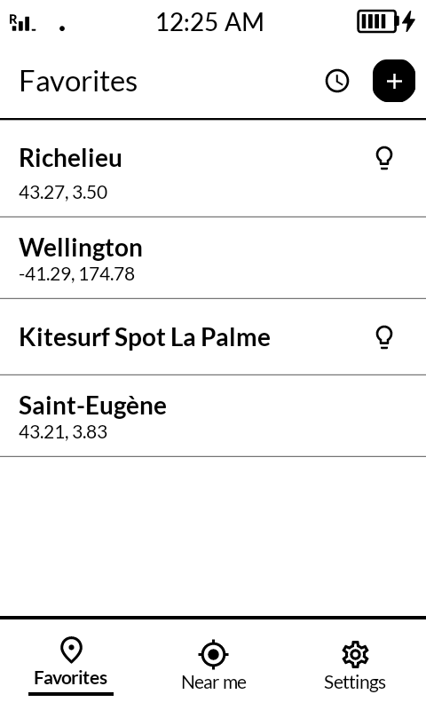
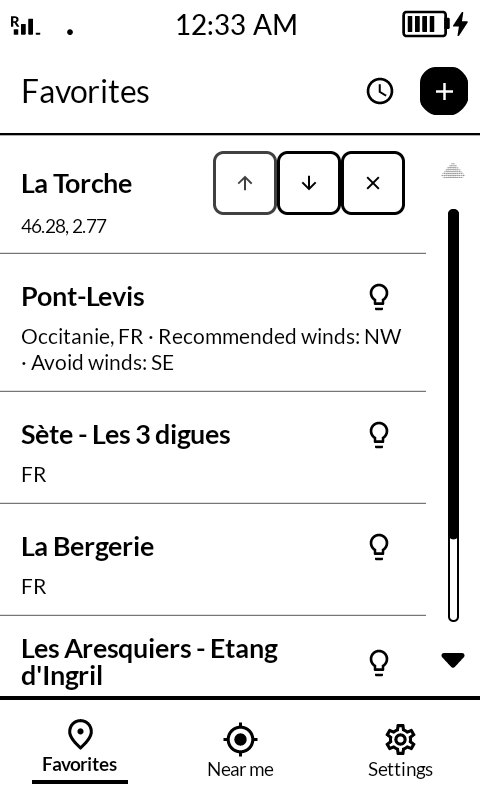
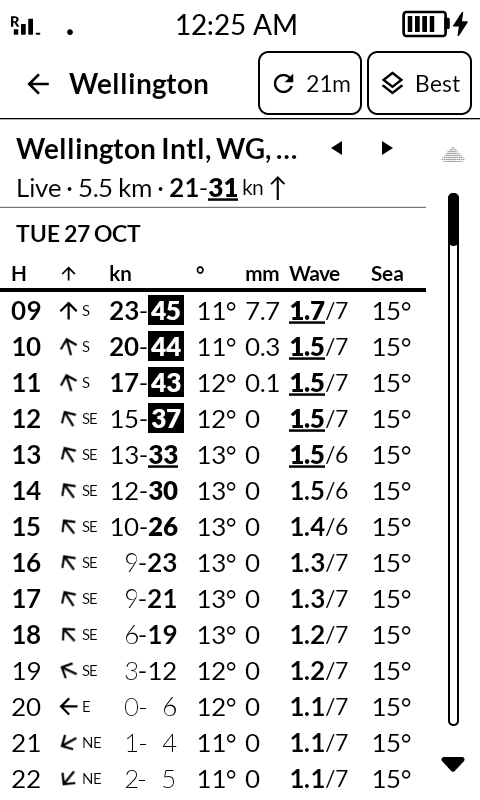
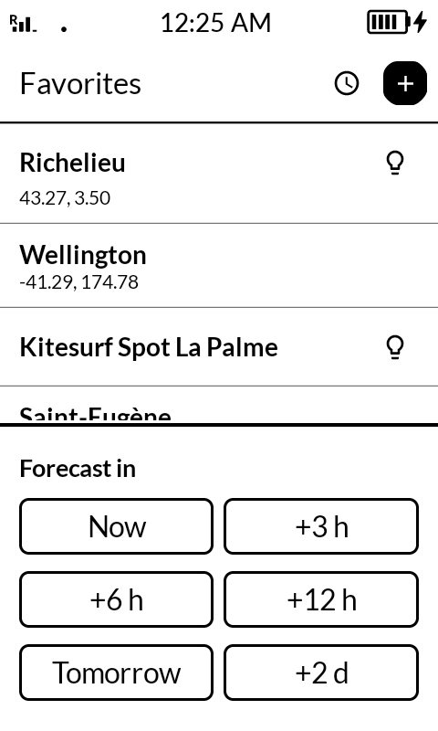
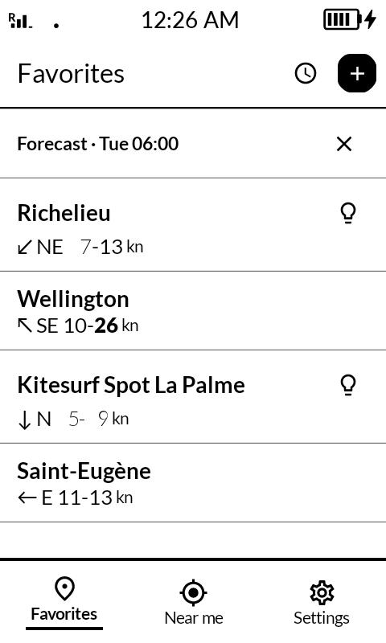
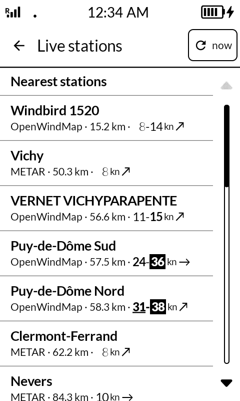
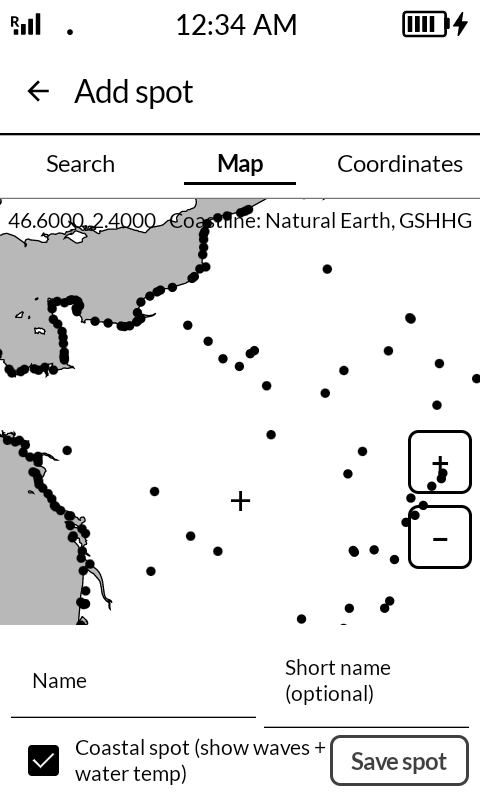
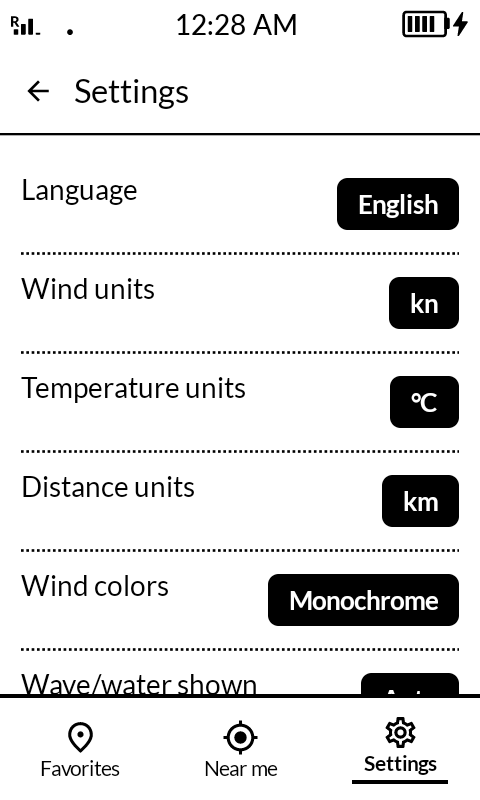
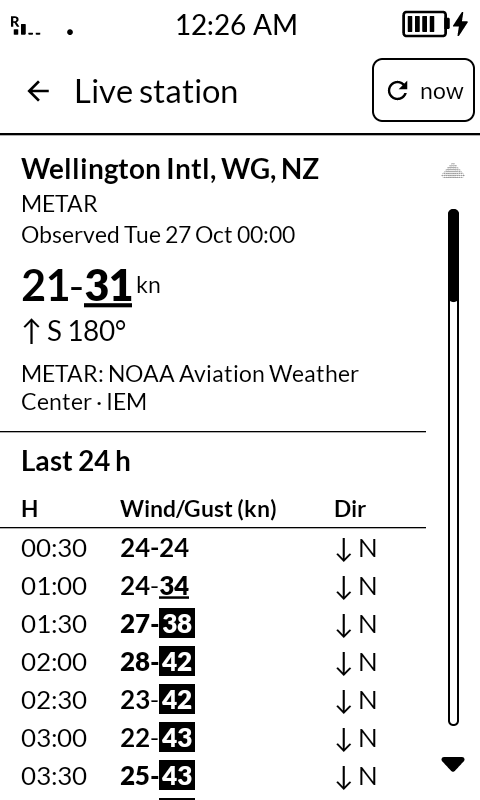
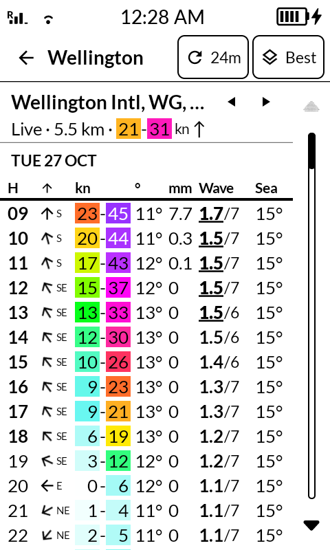

# KompaktWind

KompaktWind is a focused weather forecast app for outdoor sports: wingfoil,
kitesurf, windsurf, sailing, … targeting the Mudita Kompakt e-ink. Open-Meteo is
the default free data source, with an optional AROME FR switch.

## Screenshots

<table>
<tr>
    <td></td>
    <td></td>
    <td></td>
</tr>
<tr>
    <td></td>
    <td></td>
    <td></td>
</tr>
<tr>
    <td></td>
    <td></td>
    <td></td>
</tr>
</table>

### Optional: color mode



The Kompakt's e-ink screen is monochrome. This optional color palette is for
Android phones and tablets with color displays; the Kompakt shows the same
forecast in shades of gray.

Regenerate them on a connected device with `./scripts/capture-screenshots.sh`;
see [`screenshots/README.md`](screenshots/README.md).


## Features

- Saved spots (search, coordinates, or pick on an OpenStreetMap map)
- Choose from the available Open-Meteo models per spot via the top-right source
  button; each spot remembers its own selection
- Live wind stations: nearest OpenWindMap community stations and airport METAR
  (NOAA AWC, IEM fallback), with distance, live wind/gust, and 24 h history
- Discover spots from a sharded community catalog, no manual coordinate entry
- Distance units (km or mi)
- 7-day hourly forecast in a single dense table with sticky day headers
- Wind speed + gust, direction, air temperature, precipitation
- For coastal spots: wave height/period and water temperature
- Offline-friendly: cached forecasts shown with a clear age stamp
- Optional dark screen: all white on black, for fun
- 10 languages, using the system language by default or forced in Settings
- Configurable units (m/s, km/h, kn, mph; °C, °F)

## Build

```bash
./gradlew :app:assembleDebug
adb install app/build/outputs/apk/debug/app-debug.apk
```

Min SDK 28 (Android 9). Target SDK 35.

## Release

CI runs unit tests, lint, and a debug build on pull requests and pushes to
`main`/`master` with no signing secrets. Pushing a tag such as `v0.1.2` or
publishing a GitHub Release for a `v*` tag runs
`.github/workflows/release.yml` (the workflow must be present on the default
branch): a secret-free job checks the tag, tests, lints, and builds unsigned
APK/AAB artifacts; after the `release` environment is
approved, a separate job signs them, verifies the APK signer and AAB signature,
checks the package/version, and creates or updates the GitHub Release. The
signed APK, AAB, and SHA-256 are attached to that Release. The AAB is attached
for Play; the workflow does not upload it to Play automatically.

**Required:** configure the `release` environment with required reviewers and
store these secrets there (not at repository scope):

- `ANDROID_KEYSTORE_BASE64` — base64 of the release keystore
- `ANDROID_KEYSTORE_PASSWORD`
- `ANDROID_KEY_ALIAS`
- `ANDROID_KEY_PASSWORD`

Optionally set the public repository variable `ANDROID_SIGNER_SHA256` to the
release certificate's SHA-256 fingerprint. If it is set, the signed APK must
match it; if it is unset, the workflow still verifies both signatures and
compares the fingerprints when they are readable. Get it with:

```bash
keytool -list -v -keystore release.keystore | grep 'SHA256:'
gh variable set ANDROID_SIGNER_SHA256 --body "AA:BB:..."
```

Create the base64 value with `base64 -w0 release.keystore` on Linux
(`base64 -i release.keystore` on macOS). Never commit the keystore or
`keystore.properties`.

The version name and code come from the tag: `v0.1.2` becomes `0.1.2` and
`1002` (`major * 1,000,000 + minor * 1,000 + patch`). For a local signed build:

```bash
cp keystore.properties.example keystore.properties
# fill in the path, alias, and passwords
./gradlew :app:assembleRelease -PversionName=0.1.2 -PversionCode=1002
```

To publish from a tag:

```bash
git tag v0.1.2
git push origin v0.1.2
```

The release workflow can also be started manually with an existing tag; the
manual default is a draft Release:

```bash
gh workflow run release.yml -f tag=v0.1.2 -f draft=true
```

Tag pushes publish directly once the required-reviewer environment gate is
approved. A published GitHub Release is already visible when the approval
starts; its APK/AAB assets are attached after approval. Draft releases do not
trigger the workflow until published, so publish the draft first or run the
workflow manually with the tag. Use either the tag push or the GitHub Release
UI, not both, to avoid duplicate runs; assets on an already-published release
are not overwritten.

## Data sources

The top-right source button opens a full-screen list for the spot. Each row
shows the agency, origin country, resolution, and horizon. The list is filtered
to models that cover the spot and ordered by relevance.

| Model | Model ID | Agency | Origin | Resolution | Horizon |
|---|---|---|---|---|---|
| Best | `best_match` | Open-Meteo | Global | auto | up to 7 d |
| AROME 1.5 | `meteofrance_arome_france_hd` | Météo-France | France | 1.5 km | ~2 d |
| AROME 2.5 | `meteofrance_arome_france0025` | Météo-France | France | 2.5 km | ~2 d |
| KNMI | `knmi_harmonie_arome_europe` | KNMI | Netherlands | 2 km | ~2.5 d |
| DMI | `dmi_harmonie_arome_europe` | DMI | Denmark | 2 km | ~2.3 d |
| UKV | `ukmo_uk_deterministic_2km` | Met Office | United Kingdom | 2 km | ~2 d |
| ICON-D2 | `dwd_icon_d2` | DWD | Germany | 2.2 km | ~2 d |
| ICON-EU | `dwd_icon_eu` | DWD | Germany | 7 km | ~5 d |
| ARPEGE EU | `meteofrance_arpege_europe` | Météo-France | France | 11 km | ~4 d |
| CH2 | `meteoswiss_icon_ch2` | MeteoSwiss | Switzerland | 2 km | ~5 d |
| CH1 | `meteoswiss_icon_ch1` | MeteoSwiss | Switzerland | 1 km | ~1.2 d |
| ECMWF | `ecmwf_ifs` | ECMWF | Europe | 9 km | up to 7 d |
| GFS | `ncep_gfs_global` | NOAA | USA | 13 km | up to 7 d |
| GEM | `gem_global` | ECCC | Canada | ~15 km | up to 7 d |
| UKMO | `ukmo_global_deterministic_10km` | Met Office | United Kingdom | 10 km | up to 7 d |
| ARPEGE W | `meteofrance_arpege_world025` | Météo-France | France | 25 km | ~4 d |
| ICON | `dwd_icon` | DWD | Germany | 11 km | ~5 d |

Each spot stores its own source. Global models are always listed; regional
models appear only when the spot is inside their domain. A saved choice falls
back to Best if the spot is outside that model's coverage.

## Languages

English, French, German, Spanish, Italian, Portuguese, Dutch, Polish, Czech,
and Swedish. The app follows the system language on first use; Settings can
force a language. Adding another locale is a matter of adding a
`values-xx/strings.xml` file and one entry in `LanguageManager`.

## Architecture

- Multiple weather providers behind `ProviderRegistry` (Open-Meteo Best Match,
  AROME FR via Open-Meteo)
- Single-module Android app
- Kotlin + Jetpack Compose + Mudita Mindful Design (MMD) 1.0.0
- MVVM + StateFlow
- Retrofit + OkHttp + kotlinx-serialization
- Room for spots + forecast cache, DataStore for preferences

## Attribution

Weather data: [Open-Meteo](https://open-meteo.com) (default) or
Météo-France AROME via Open-Meteo. Open-Meteo's free tier is non-commercial.
Place-name search uses Open-Meteo's geocoding API. The map picker is
offline: coastlines and land polygons come from Natural Earth (public domain)
and, at high zoom in Europe, from
[GSHHG](https://github.com/GenericMappingTools/gshhg-gmt) (LGPL-3.0) by
Wessel & Smith.

Live wind data comes from the PiouPiou/OpenWindMap community network and
airport METAR reports (NOAA Aviation Weather Center, with IEM as fallback).
OpenWindMap: wind data © OpenWindMap contributors. Live responses are cached
for 5 minutes and history for 10 minutes; manual refresh bypasses the cache.
No API key is required.

The spot catalog is under `spots/`: `manifest.json`, `spots.index.json`, plus
sharded `spots.<floor(lat)>_<floor(lon)>.json` files. A Gradle task copies them
into the app assets, so Discover works offline. The catalog is updated only
with app releases; there is no network refresh yet. Catalog facts come from
OpenStreetMap (166 OSM wind-sport elements after
excluding shops, schools and clubs). Merged spots keep alternate names and are searchable by them.
Descriptions and wind directions are only included where we have permission
to reuse them. OpenStreetMap-derived data is © OpenStreetMap contributors,
ODbL 1.0; the catalog database is distributed under ODbL 1.0.
The OFB/N2Glisse datasets are not included yet: their data.gouv.fr records
currently expose no downloadable resources and no specified licence.

## License

MIT. See [LICENSE](LICENSE).
